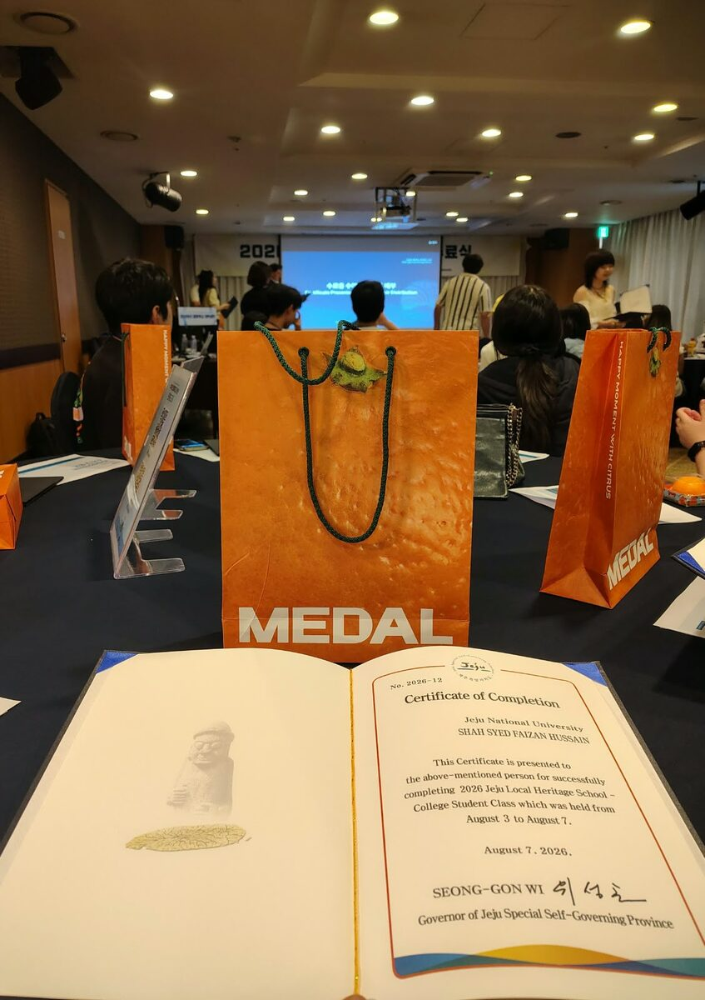
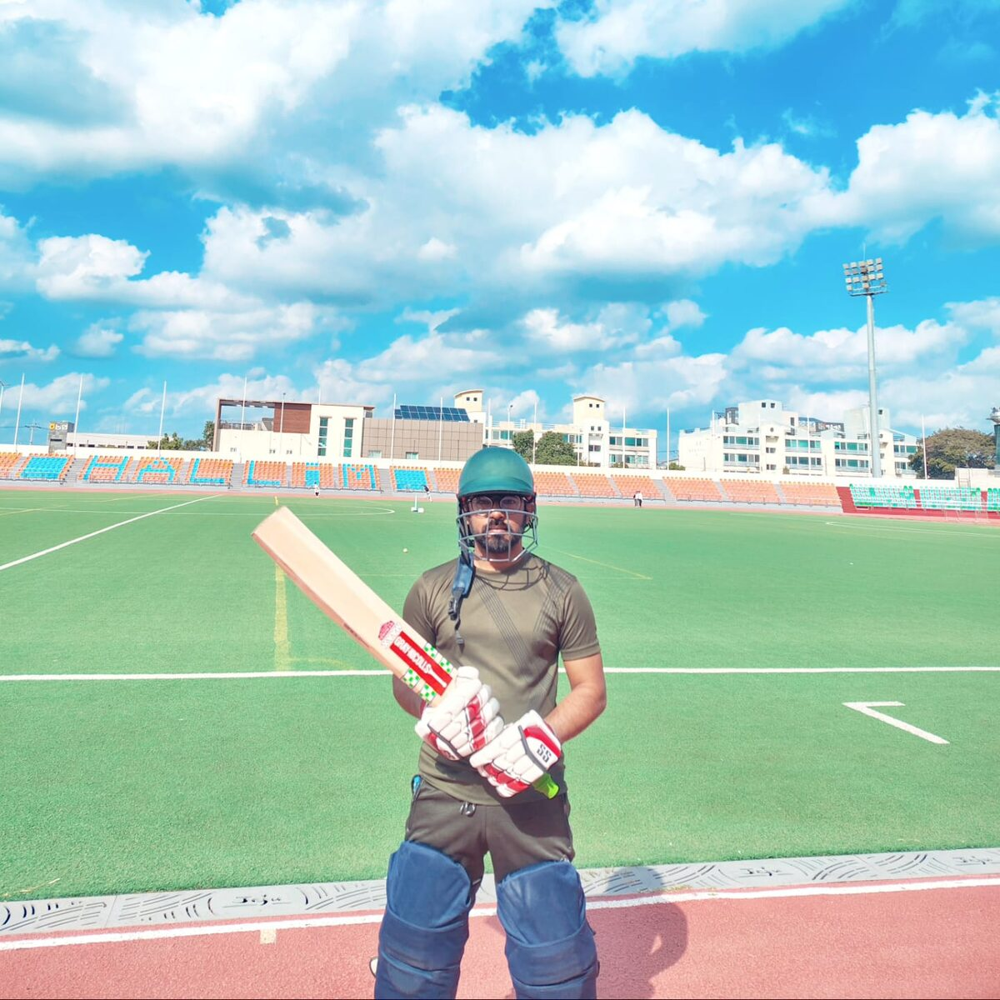
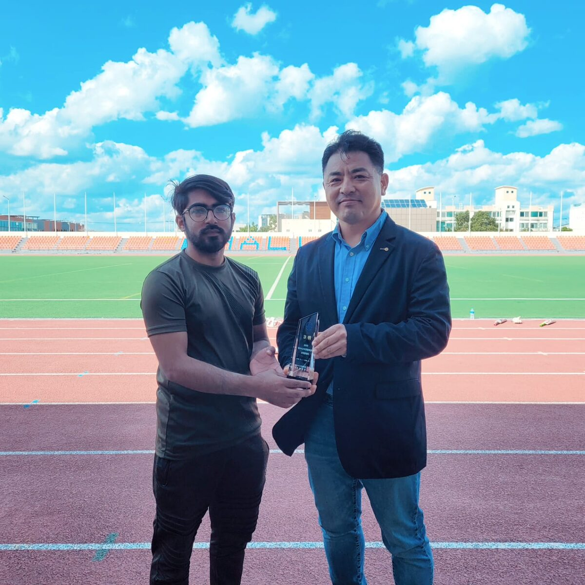
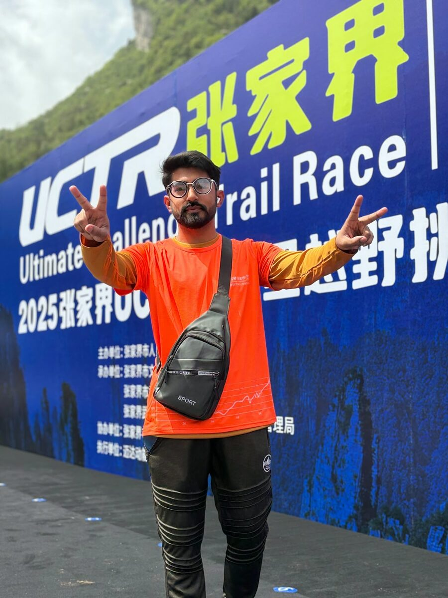
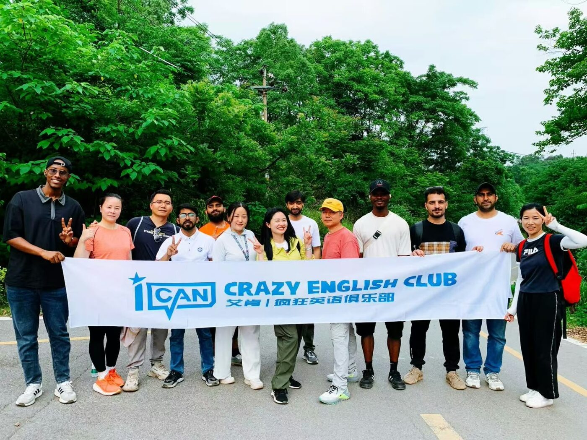
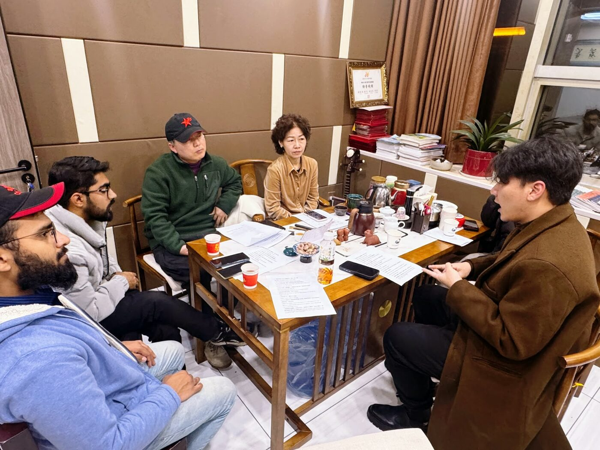
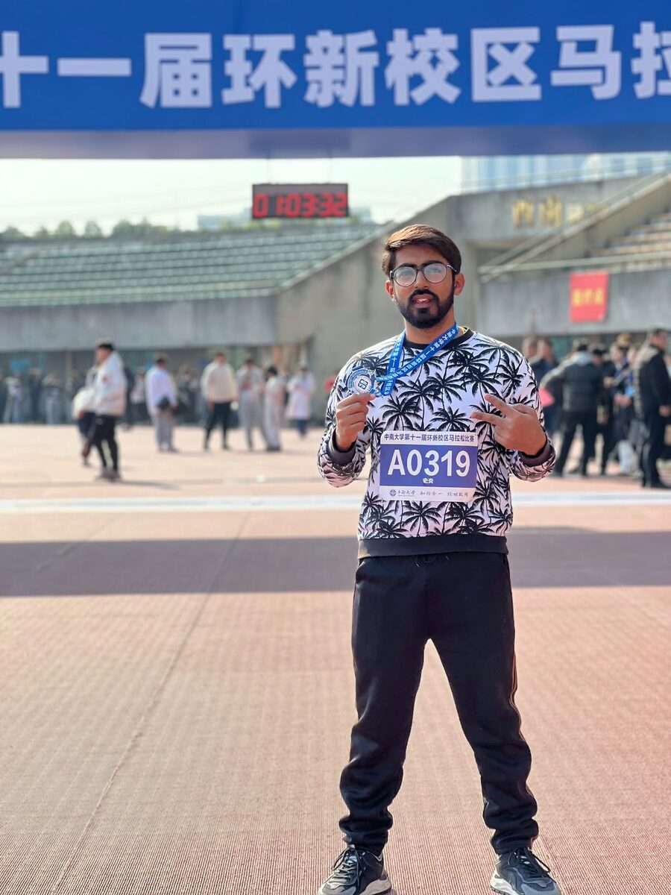

Sports, outdoor challenges, cultural programs, and community activities outside the lab.

  

    
  

  

    📅 Aug 2026 · Jeju, South Korea
    <h3 class="act-title">Jeju Local Heritage School 🏛️</h3>
    
Completed the 2026 Jeju Local Heritage School (3–7 August), a five-day program on Jeju's culture and heritage, with a certificate from the Governor of Jeju Special Self-Governing Province.

  

  

    
  

  

    📅 Jan 2026 · Jeju, South Korea
    <h3 class="act-title">Mt. Hallasan Summit 🏔️</h3>
    
Climbed to the summit of Mt. Hallasan (1,947 m), South Korea's highest peak and a UNESCO World Heritage site, and received the official summit certificate.

  

  

    
    
  

  

    📅 1–2 Nov 2025 · Hallim Sports Complex, Jeju
    <h3 class="act-title">Jeju City Cricket Association President's Cup 🏏</h3>
    
Played in the 2025 제주시 크리켓협회장배 크리켓대회 (Jeju City Cricket Association President's Cup) at Hallim Sports Complex and finished <strong>3rd place</strong>, receiving the trophy from the Association President.

  

  

    
  

  

    📅 2025 · Zhangjiajie, China
    <h3 class="act-title">UCTR Ultimate Challenge Trail Race 🏃‍♂️</h3>
    
Ran the 10 km course of the 2025 Zhangjiajie Ultimate Challenge Trail Race through the mountain scenery of Zhangjiajie.

  

  

    
  

  

    📅 May 2025 · Hunan, China
    <h3 class="act-title">Group Hiking 🥾</h3>
    
Hiking trip to 水青山生态农湾 (Shuiqingshan Eco-Farm) with the iCAN Crazy English Club, together with local and international peoples.

  

  

    
  

  

    📅 Feb 2025 · Hunan, China
    <h3 class="act-title">Language Exchange 🗣️</h3>
    
Took part in a Chinese–English language exchange meetup with local residents and international students.

  

  

    
    
  

  

    📅 Dec 2024 · Changsha, China
    <h3 class="act-title">CSU Campus Marathon 🏅</h3>
    
Completed the 11th Central South University Around-the-New-Campus Marathon in 50 min 21 s (bib A0319) and received the finisher's medal.

  

  

    
  

  

    📅 Nov 2024 · Changsha, China
    <h3 class="act-title">CSU Autumn Mountain-Climbing Festival 🥾</h3>
    
Took part in Central South University's first Autumn Mountain-Climbing Festival, finishing the route in 48 min 12 s.

  

<!-- copy one 
 … 
 block per activity.
     class="act" = landscape frame (4:3); class="act act--tall" = portrait frame (3:4). -->

