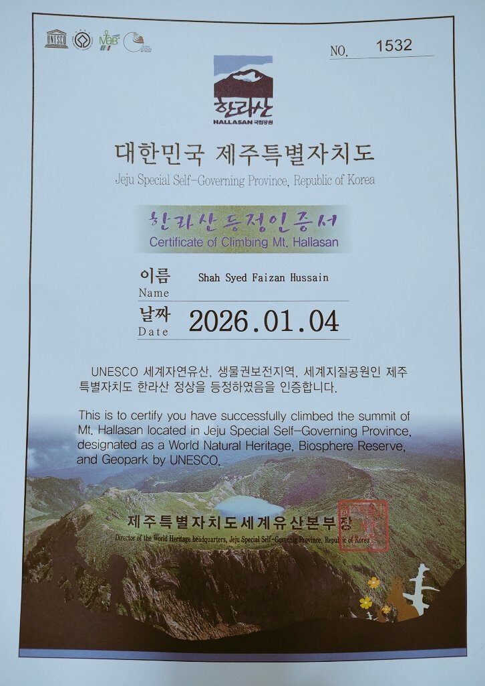

Sports, outdoor challenges, and other activities outside the lab.

  

    
  

  

    📅 Jan 2026 · Jeju, South Korea
    <h3 class="act-title">Mt. Hallasan Summit 🏔️</h3>
    
Climbed to the summit of Mt. Hallasan (1,947 m), South Korea's highest peak and a UNESCO World Heritage site, and received the official summit certificate.

  

  

    
  

  

    📅 Dec 2024 · Changsha, China
    <h3 class="act-title">CSU Campus Marathon 🏃</h3>
    
Completed the 11th Central South University Around-the-New-Campus Marathon in 50 min 21 s (bib A0319).

  

  

    
  

  

    📅 Nov 2024 · Changsha, China
    <h3 class="act-title">CSU Autumn Mountain-Climbing Festival 🥾</h3>
    
Took part in Central South University's first Autumn Mountain-Climbing Festival, finishing the route in 48 min 12 s.

  

<!-- copy one 
 … 
 block per activity.
     Use class="act" for landscape photos (4:3 frame) or "act act--tall" for portrait photos/certificates (3:4 frame). -->

