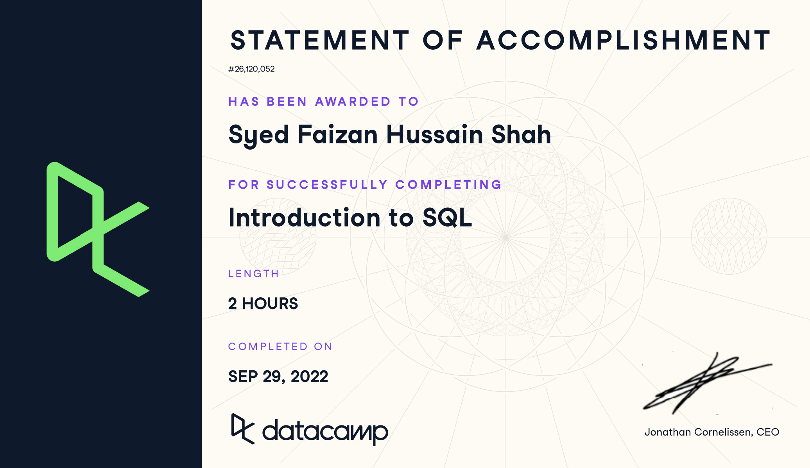
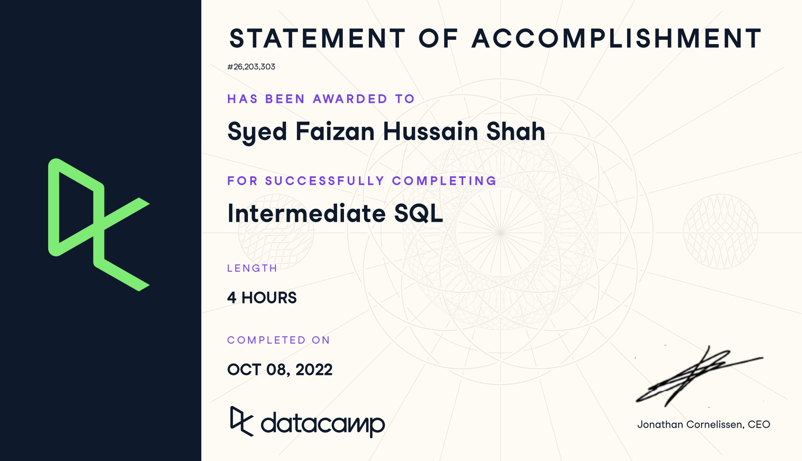
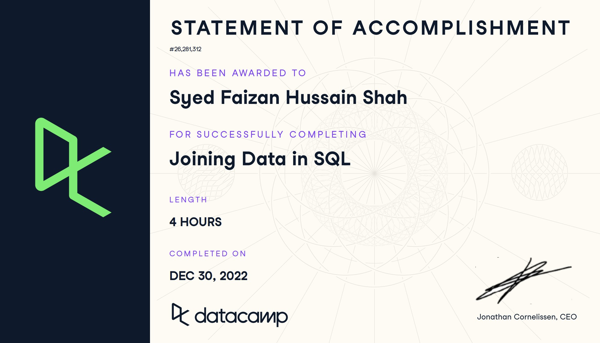
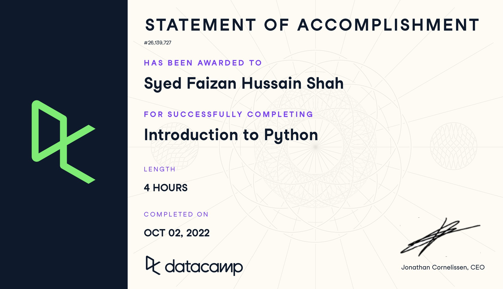
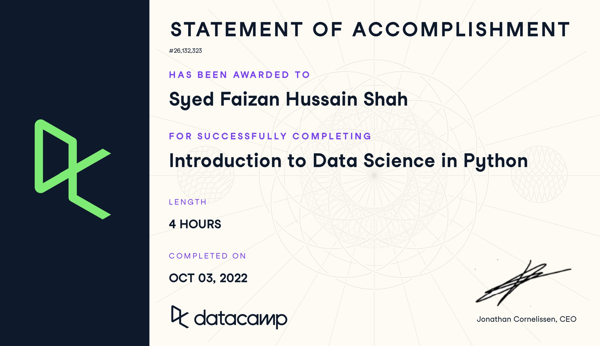
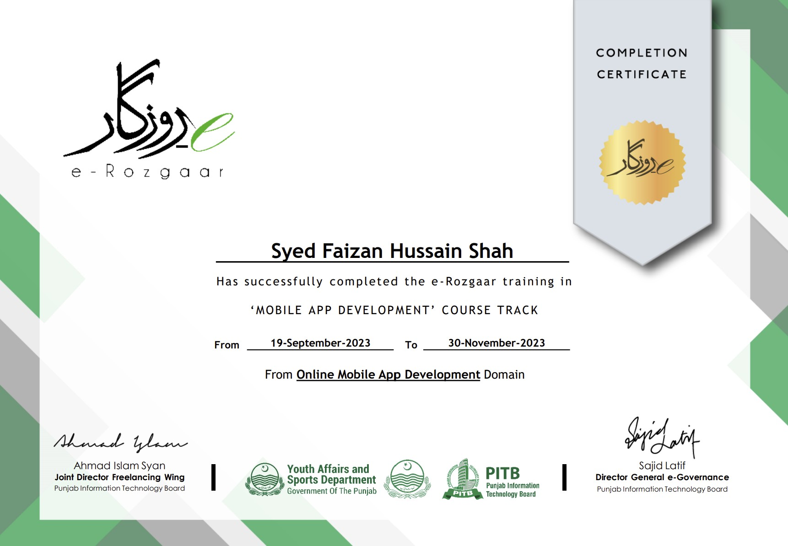

## DataCamp

  <a class="cert" href="/images/certifications/datacamp-introduction-to-sql.jpg" target="_blank" rel="noopener">
    
    Introduction to SQL
    DataCamp
  </a>
  <a class="cert" href="/images/certifications/datacamp-intermediate-sql.jpg" target="_blank" rel="noopener">
    
    Intermediate SQL
    DataCamp
  </a>
  <a class="cert" href="/images/certifications/datacamp-joining-data-in-sql.jpg" target="_blank" rel="noopener">
    
    Joining Data in SQL
    DataCamp
  </a>
  <a class="cert" href="/images/certifications/datacamp-introduction-to-python.jpg" target="_blank" rel="noopener">
    
    Introduction to Python
    DataCamp
  </a>
  <a class="cert" href="/images/certifications/datacamp-introduction-to-data-science.jpg" target="_blank" rel="noopener">
    
    Introduction to Data Science
    DataCamp
  </a>

## Coursera

  <a class="cert" href="/images/certifications/coursera-ai-for-everyone.jpg" target="_blank" rel="noopener">
    
    AI For Everyone
    Coursera
  </a>
  <a class="cert" href="/images/certifications/coursera-programming-with-python.jpg" target="_blank" rel="noopener">
    
    Programming with Python
    Coursera
  </a>
  <a class="cert" href="/images/certifications/coursera-python-data-structures.jpg" target="_blank" rel="noopener">
    
    Python Data Structures
    Coursera
  </a>
  <a class="cert" href="/images/certifications/coursera-python-for-data-science-ai.jpg" target="_blank" rel="noopener">
    
    Python for Data Science &amp; AI
    Coursera
  </a>
  <a class="cert" href="/images/certifications/coursera-python-project-for-data-science.jpg" target="_blank" rel="noopener">
    
    Python Project for Data Science
    Coursera
  </a>
  <a class="cert" href="/images/certifications/coursera-data-analytics-essentials.jpg" target="_blank" rel="noopener">
    
    Data Analytics Essentials
    Coursera
  </a>
  <a class="cert" href="/images/certifications/coursera-data-visualization-with-excel.jpg" target="_blank" rel="noopener">
    
    Data Visualization with Excel
    Coursera
  </a>
  <a class="cert" href="/images/certifications/coursera-using-python-to-access-web-data.jpg" target="_blank" rel="noopener">
    
    Using Python to Access Web Data
    Coursera
  </a>
  <a class="cert" href="/images/certifications/coursera-using-databases-with-python.jpg" target="_blank" rel="noopener">
    
    Using Databases with Python
    Coursera
  </a>

## IBM

  <a class="cert" href="/images/certifications/ibm-introduction-to-data-analytics.jpg" target="_blank" rel="noopener">
    
    Introduction to Data Analytics
    IBM
  </a>
  <a class="cert" href="/images/certifications/ibm-excel-essentials-for-data-analytics.jpg" target="_blank" rel="noopener">
    
    Excel Essentials for Data Analytics
    IBM
  </a>

## E-Rozgaar

  <a class="cert" href="/images/certifications/e-rozgaar-mobile-app-development-react-native.jpg" target="_blank" rel="noopener">
    
    Mobile App Development (React Native)
    E-Rozgaar
  </a>

## DigiSkills

  <a class="cert" href="/images/certifications/digiskills-freelancing.jpg" target="_blank" rel="noopener">
    
    Freelancing
    DigiSkills
  </a>

