## Coursera

### University of Michigan — Python for Everybody Specialization

  <a class="cert-img" href="/images/certifications/umich-python-for-everybody-specialization.jpg" target="_blank" rel="noopener">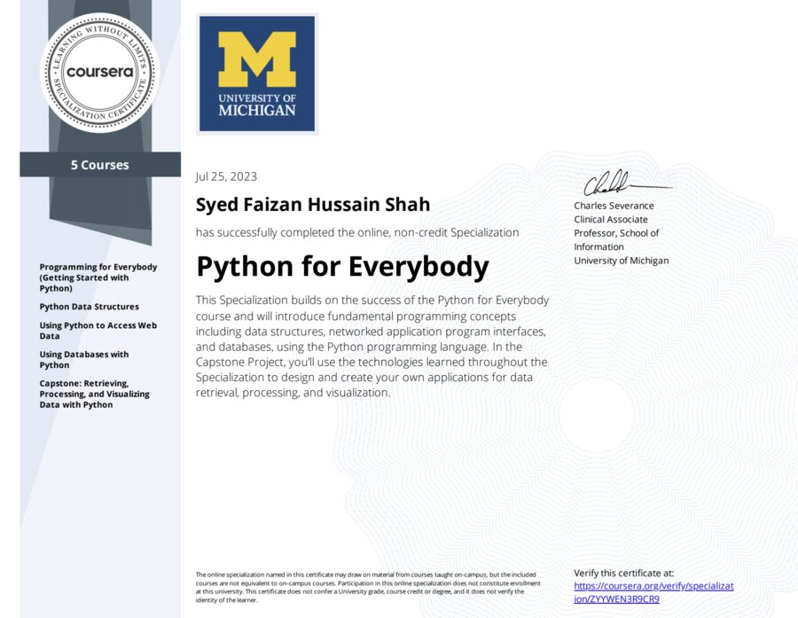</a>
  

    Python for Everybody (Specialization, 5 courses)
    University of Michigan · Jul 2023
    <a class="cert-verify" href="https://coursera.org/verify/specialization/ZYYWEN3R9CR9" target="_blank" rel="noopener">Verify ↗</a>
  

  
  

    Programming for Everybody (Getting Started with Python)
    University of Michigan · Feb 2023
    <a class="cert-verify" href="https://coursera.org/verify/26NF6GCPN29V" target="_blank" rel="noopener">Verify ↗</a>
  

  
  

    Python Data Structures
    University of Michigan · Feb 2023
    <a class="cert-verify" href="https://coursera.org/verify/G7MGM788P644" target="_blank" rel="noopener">Verify ↗</a>
  

  
  

    Using Python to Access Web Data
    University of Michigan · Feb 2023
    <a class="cert-verify" href="https://coursera.org/verify/GDQFT9KNSGWR" target="_blank" rel="noopener">Verify ↗</a>
  

  <a class="cert-img" href="/images/certifications/umich-using-databases-with-python.jpg" target="_blank" rel="noopener">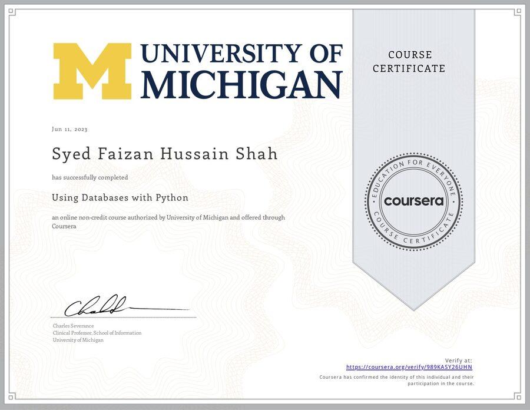</a>
  

    Using Databases with Python
    University of Michigan · Jun 2023
    <a class="cert-verify" href="https://coursera.org/verify/989KASY26UHN" target="_blank" rel="noopener">Verify ↗</a>
  

  <a class="cert-img" href="/images/certifications/umich-capstone-python.jpg" target="_blank" rel="noopener">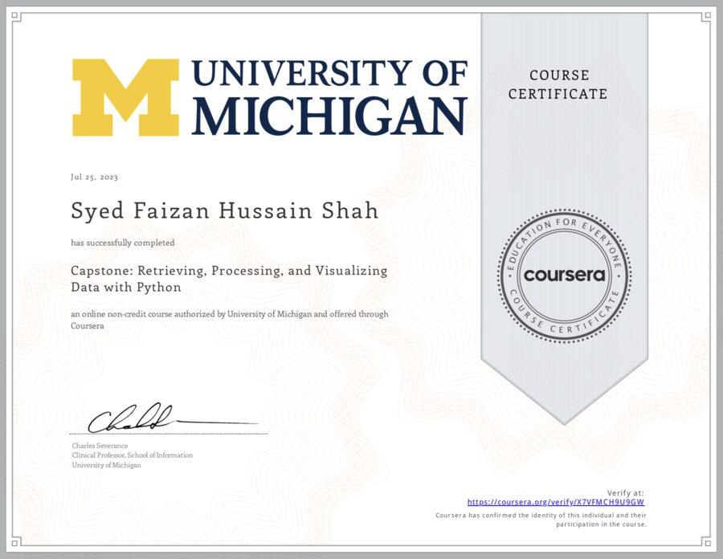</a>
  

    Capstone: Retrieving, Processing, and Visualizing Data with Python
    University of Michigan · Jul 2023
    <a class="cert-verify" href="https://coursera.org/verify/X7VFMCH9U9GW" target="_blank" rel="noopener">Verify ↗</a>
  

### IBM Skills Network

  <a class="cert-img" href="/images/certifications/ibm-python-for-data-science-ai-development.jpg" target="_blank" rel="noopener">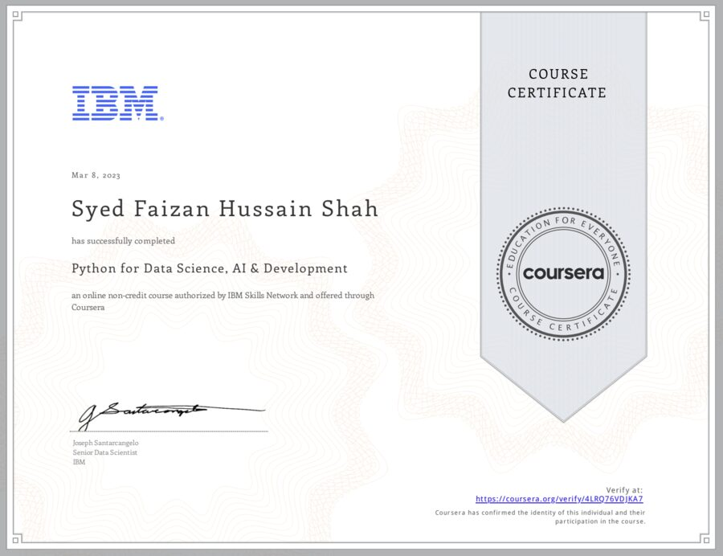</a>
  

    Python for Data Science, AI &amp; Development
    IBM · Mar 2023
    <a class="cert-verify" href="https://coursera.org/verify/4LRQ76VDJKA7" target="_blank" rel="noopener">Verify ↗</a>
  

  <a class="cert-img" href="/images/certifications/ibm-python-project-for-data-science.jpg" target="_blank" rel="noopener">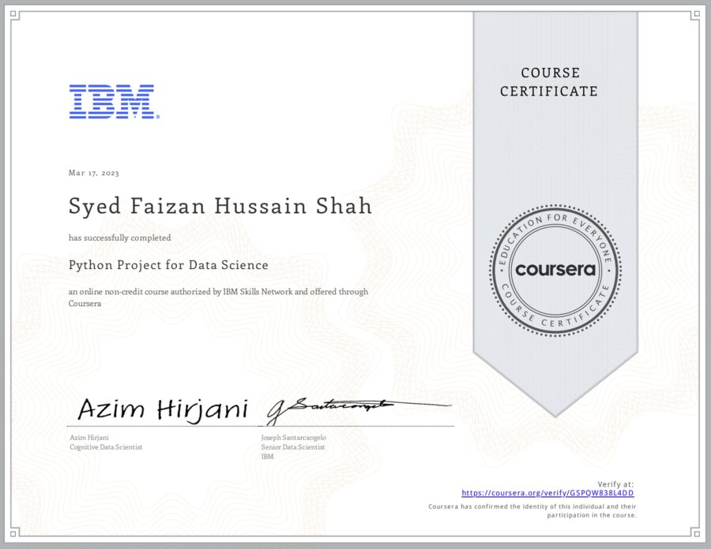</a>
  

    Python Project for Data Science
    IBM · Mar 2023
    <a class="cert-verify" href="https://coursera.org/verify/GSPQW838L4DD" target="_blank" rel="noopener">Verify ↗</a>
  

  <a class="cert-img" href="/images/certifications/ibm-data-analysis-with-python.jpg" target="_blank" rel="noopener">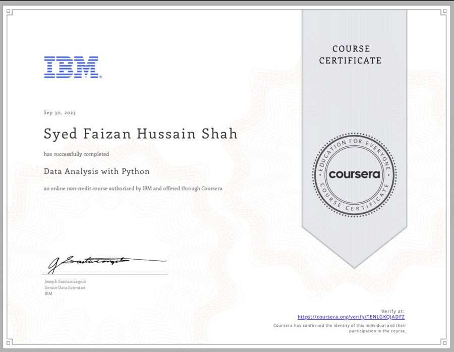</a>
  

    Data Analysis with Python
    IBM · Sep 2023
    <a class="cert-verify" href="https://coursera.org/verify/TENLGKQJADFZ" target="_blank" rel="noopener">Verify ↗</a>
  

  <a class="cert-img" href="/images/certifications/ibm-databases-and-sql-for-data-science.jpg" target="_blank" rel="noopener">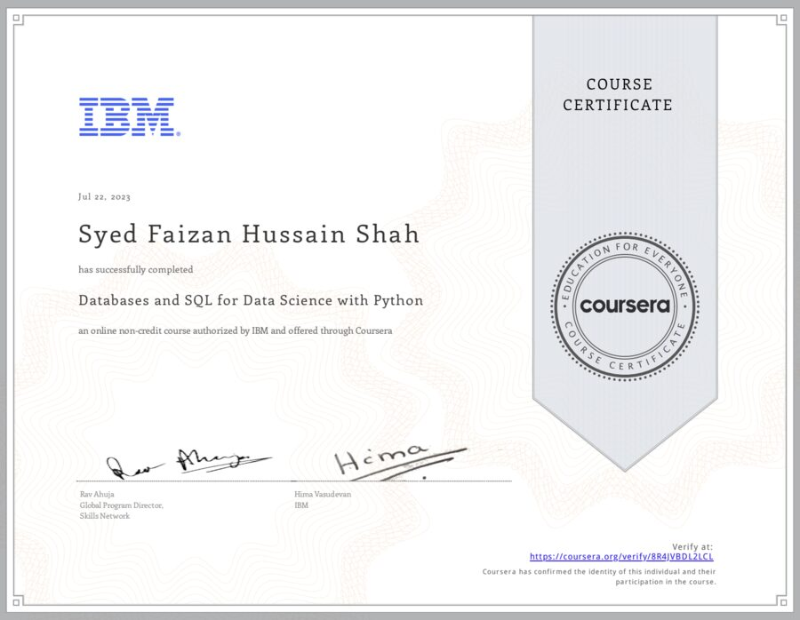</a>
  

    Databases and SQL for Data Science with Python
    IBM · Jul 2023
    <a class="cert-verify" href="https://coursera.org/verify/8R4JVBDL2LCL" target="_blank" rel="noopener">Verify ↗</a>
  

  <a class="cert-img" href="/images/certifications/ibm-excel-basics-for-data-analysis.jpg" target="_blank" rel="noopener">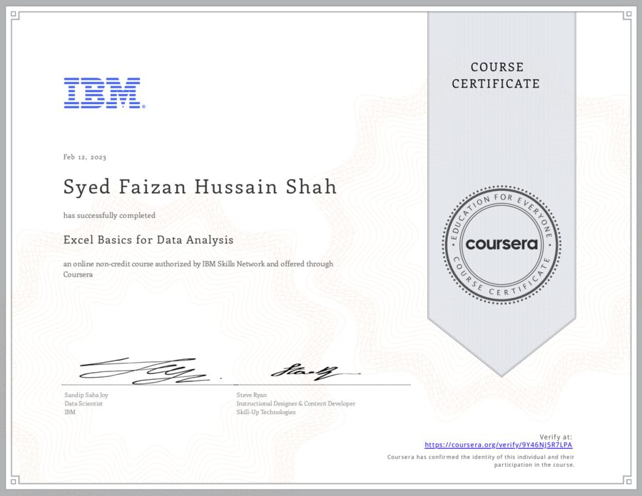</a>
  

    Excel Basics for Data Analysis
    IBM · Feb 2023
    <a class="cert-verify" href="https://coursera.org/verify/9Y46NJ5R7LPA" target="_blank" rel="noopener">Verify ↗</a>
  

  <a class="cert-img" href="/images/certifications/ibm-data-visualization-dashboards-excel-cognos.jpg" target="_blank" rel="noopener">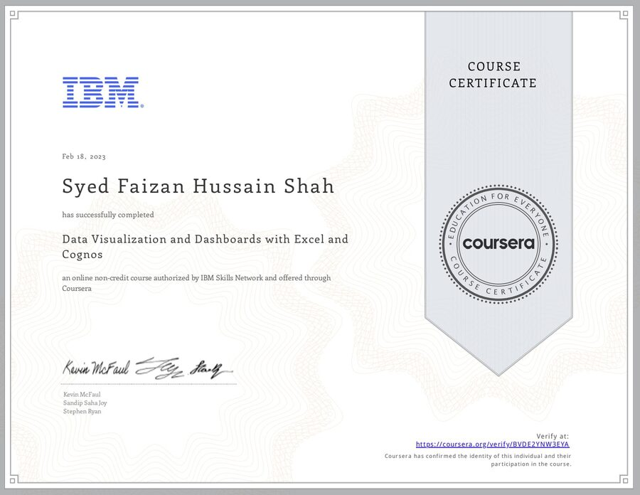</a>
  

    Data Visualization and Dashboards with Excel and Cognos
    IBM · Feb 2023
    <a class="cert-verify" href="https://coursera.org/verify/BVDE2YNW3EYA" target="_blank" rel="noopener">Verify ↗</a>
  

### DeepLearning.AI

  <a class="cert-img" href="/images/certifications/deeplearningai-ai-for-everyone.jpg" target="_blank" rel="noopener">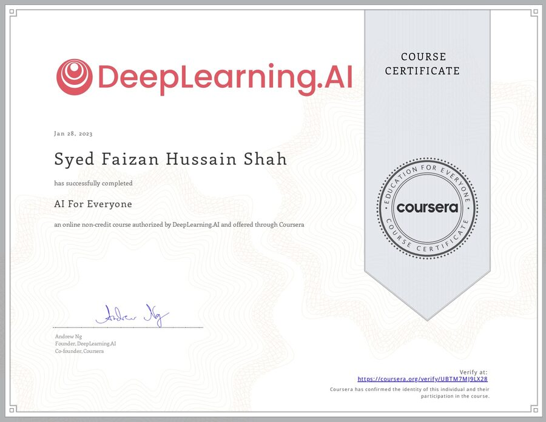</a>
  

    AI For Everyone
    DeepLearning.AI · Andrew Ng · Jan 2023
    <a class="cert-verify" href="https://coursera.org/verify/UBTM7MJ9LX28" target="_blank" rel="noopener">Verify ↗</a>
  

## IBM Digital Badges (Credly)

  <a class="cert-img" href="/images/certifications/badge-python-for-data-science-ai.jpg" target="_blank" rel="noopener">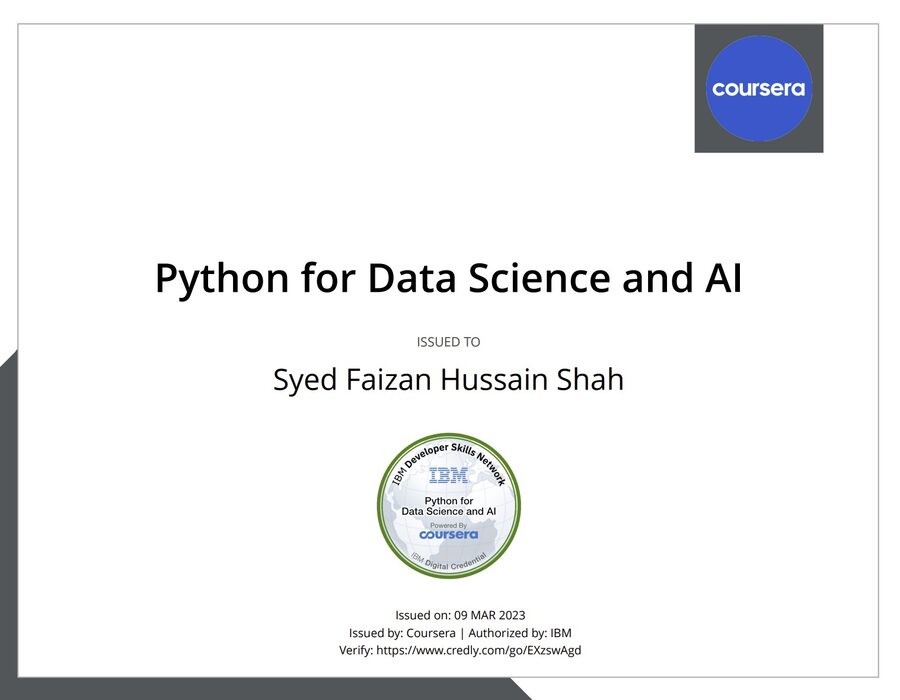</a>
  

    Python for Data Science and AI
    IBM Developer Skills Network · Mar 2023
    <a class="cert-verify" href="https://www.credly.com/go/EXzswAgd" target="_blank" rel="noopener">Verify ↗</a>
  

  <a class="cert-img" href="/images/certifications/badge-data-analytics-essentials.jpg" target="_blank" rel="noopener">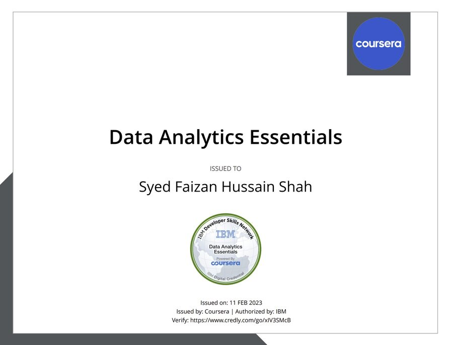</a>
  

    Data Analytics Essentials
    IBM Developer Skills Network · Feb 2023
    <a class="cert-verify" href="https://www.credly.com/go/xIV3SMcB" target="_blank" rel="noopener">Verify ↗</a>
  

  <a class="cert-img" href="/images/certifications/badge-databases-and-sql-for-data-science.jpg" target="_blank" rel="noopener">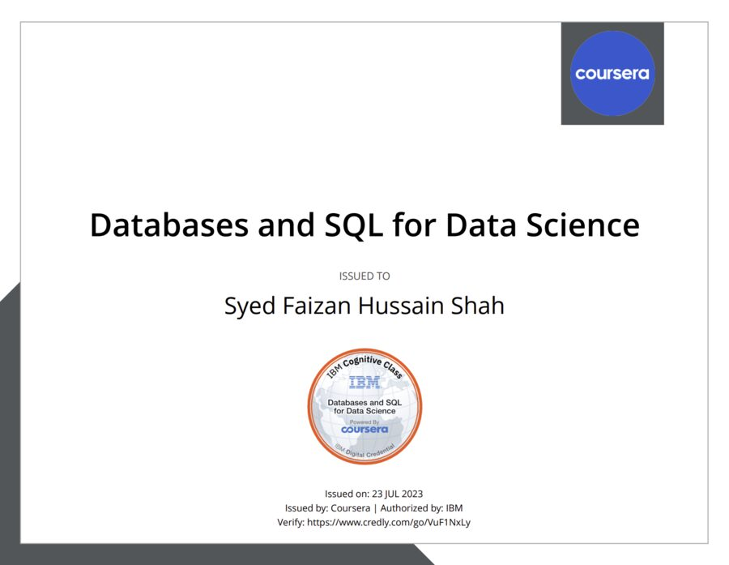</a>
  

    Databases and SQL for Data Science
    IBM Cognitive Class · Jul 2023
    <a class="cert-verify" href="https://www.credly.com/go/VuF1NxLy" target="_blank" rel="noopener">Verify ↗</a>
  

  <a class="cert-img" href="/images/certifications/badge-data-visualization-dashboard-essentials.jpg" target="_blank" rel="noopener">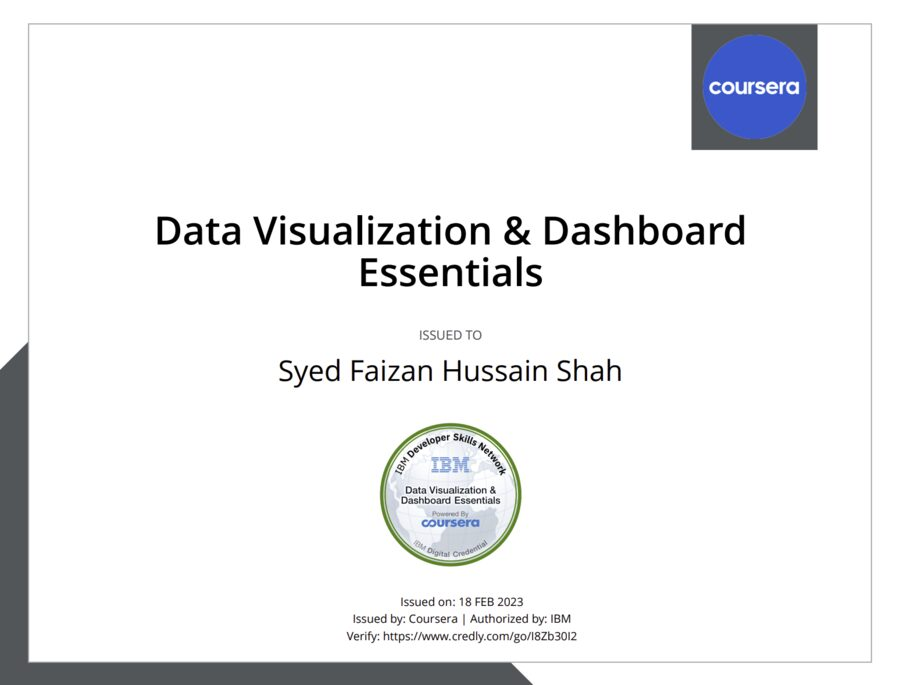</a>
  

    Data Visualization &amp; Dashboard Essentials
    IBM Developer Skills Network · Feb 2023
    <a class="cert-verify" href="https://www.credly.com/go/I8Zb30I2" target="_blank" rel="noopener">Verify ↗</a>
  

## DataCamp

  
  

    Introduction to SQL
    DataCamp · 2 hrs · Sep 2022
  

  
  

    Intermediate SQL
    DataCamp · 4 hrs · Oct 2022
  

  
  

    Joining Data in SQL
    DataCamp · 4 hrs · Dec 2022
  

  
  

    Introduction to Python
    DataCamp · 4 hrs · Oct 2022
  

  
  

    Introduction to Data Science in Python
    DataCamp · 4 hrs · Oct 2022
  

## Other

  
  

    Mobile App Development (React Native) — Course Track
    e-Rozgaar · PITB, Government of the Punjab · Sep–Nov 2023
  

  
  

    Freelancing
    DigiSkills.pk · Virtual University &amp; Ignite · Jan 2021
    <a class="cert-verify" href="https://digiskills.pk/verify" target="_blank" rel="noopener">Verify (ID FJ7YMYPQ5) ↗</a>
  

