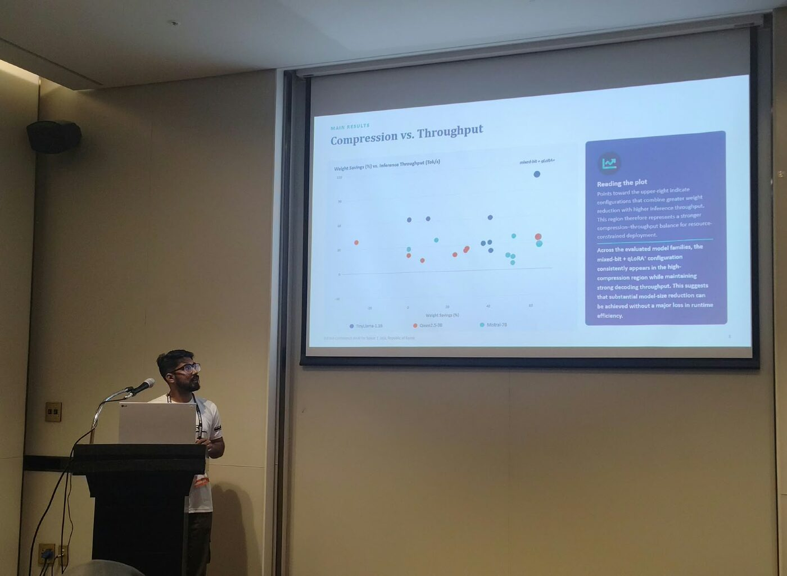
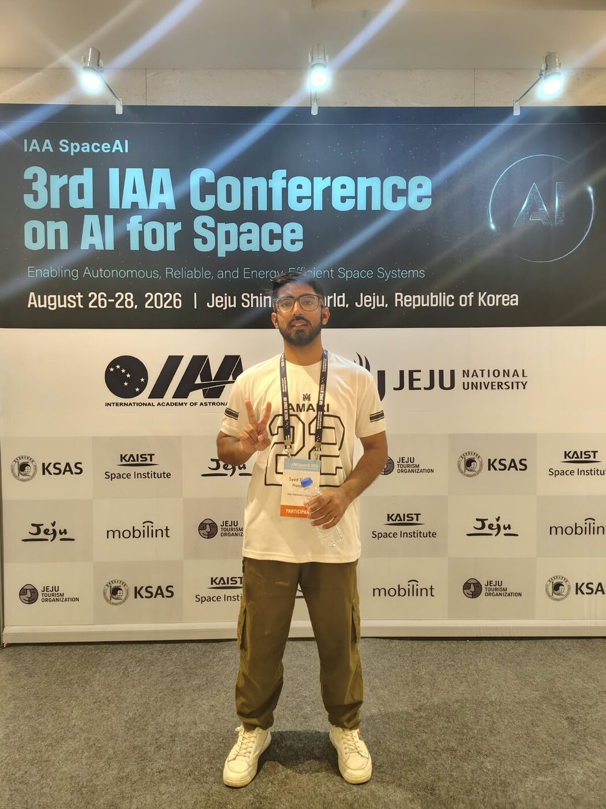
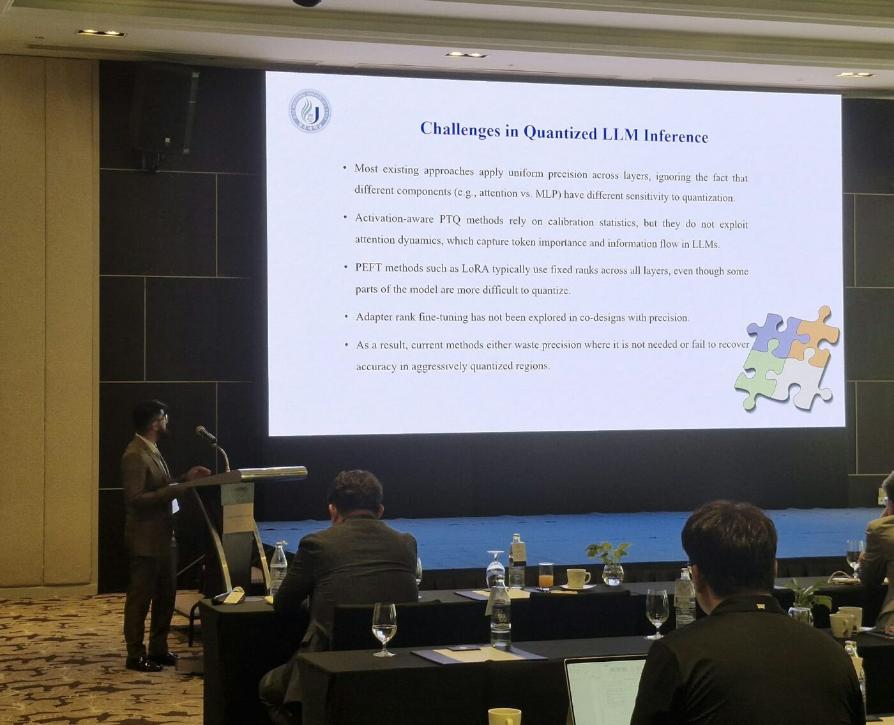
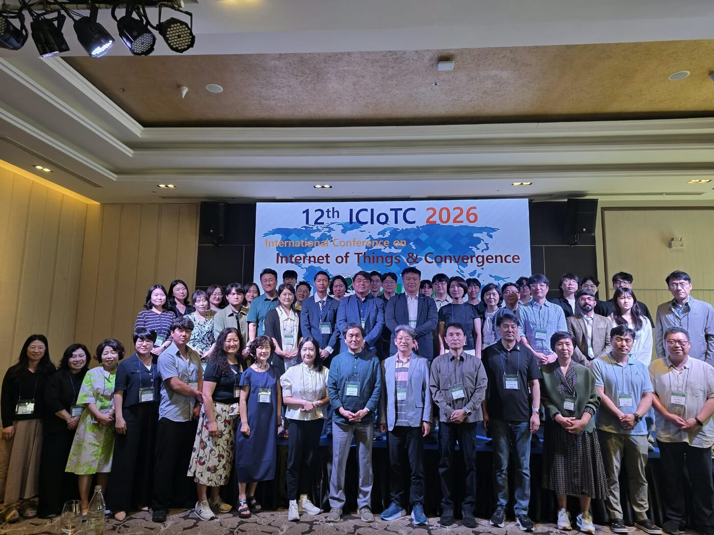

Conference presentations and invited talks.

  

    

      
      
    

  

  

    

      Conference Talk
      📅 26–28 Aug 2026
    

    <h3 class="talk-title">Efficient LLM Compression: Balancing Throughput and Accuracy</h3>
    
🏛 3rd IAA Conference on AI for Space (IAA SpaceAI 2026) · Jeju Shinhwa World, Jeju, Republic of Korea

    
Presented our work on mixed-bit quantization and parameter-efficient fine-tuning for resource-constrained LLM deployment, with results on the compression–throughput trade-off, at the International Academy of Astronautics conference on AI for autonomous, reliable, and energy-efficient space systems.

    
LLM QuantizationEfficient InferenceAI for Space

  

  

    

      
      
    

  

  

    

      Oral Presentation
      🏆 Best Research Paper Award
      📅 Jan 2026
    

    <h3 class="talk-title">Preliminary Study on Mixed-Bit Quantization and Adaptive qLoRA⁺ Fine-Tuning for Efficient LLM</h3>
    
🏛 12th International Conference on Internet of Things and Convergence (ICIoTC 2026) · Phuket, Thailand

    
Oral presentation of our study on attention-aware mixed-bit quantization combined with adaptive qLoRA⁺ fine-tuning, covering the challenges of quantized LLM inference and the resulting accuracy–memory trade-offs. The paper received the conference's Best Research Paper Award.

    
Mixed-Bit QuantizationqLoRA⁺PEFTIoT

  

